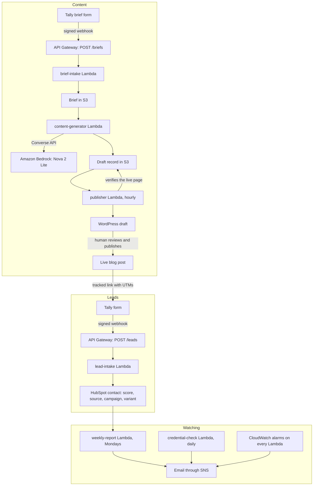

**Demo video:** <https://youtu.be/ukVd7FQq2fg>

# FlowDesk: a small AI marketing operations platform on AWS

FlowDesk turns a content brief from a simple form into AI-written drafts, checks them, puts them in front of a human for approval, publishes them to WordPress, and tracks every lead they bring in all the way into HubSpot. Every Monday it emails a report of what happened, what worked, what failed and what to do next. It watches itself too: alarms, a daily credential check and saved log searches catch failures before they cost leads.

**Scope:** a self-directed build for a made-up B2B brand (FlowDesk, client onboarding software for small agencies), using test leads and **sample ad spend**. The pipeline, checks and integrations are real and running.

---

## How it fits together



---

## What broke, and how I fixed it

The failures taught me more than the building did. Each one has a write-up in [`docs/incidents/`](docs/incidents/) or [`docs/decisions.md`](docs/decisions.md).

- **A HubSpot key stopped working** (drill). The alarm emailed me, the logs showed a 401, and after I fixed the key, Tally's automatic retry delivered the lead. No lead was lost.
- **A WordPress password was revoked** (drill). The daily credential check caught it and named the exact key before any post needed it. I rotated it with zero downtime.
- **A lead arrived with no attribution** (drill). Nothing crashed and no alarm fired. A saved log search found it, and the weekly report now flags it. Lesson: alarms only catch crashes, so data problems need their own checks.
- **A new AWS account had a Bedrock quota of zero.** I raised it with AWS and kept building against a fake model with the same JSON shape, then switched one setting when the quota arrived.
- **The model broke my brand rules.** Real Nova output came back too short, with rhetorical questions and em dashes. Four prompt versions and a repair loop fixed it, and every change is logged in [`prompts/changelog.md`](prompts/changelog.md).
- **The AI judge was unreliable.** Version 1 missed invented features. Version 2 over-flagged. Instead of tuning it forever, I made it advisory: flagged drafts go to WordPress with a red review box, and the publisher refuses to mark a post published until a human has removed it.
- **A deploy didn't contain what I thought it did.** Every draft records which prompt versions wrote it, and the records showed v3 when I believed I'd shipped v4. I now check the deployed code after every upload.
- **The weekly report dropped a week of ad spend.** It only counted weeks that started inside the report period. I found it by checking the email against a calculator, fixed it to count overlapping weeks, and added a test so it can't come back.

---

## The parts

| Lambda | Triggered by | What it does | Safeguards |
|---|---|---|---|
| `flowdesk-brief-intake` | Tally brief form through API Gateway | Turns a marketer's form answers into a brief in S3, which starts the content generator | Checks Tally's HMAC signature. The form is password protected. The brief ID comes from the submission, and S3 only writes it if it doesn't exist yet, so a repeated delivery can't start a second draft. Can only write to `briefs/` |
| `flowdesk-lead-intake` | Tally webhook through API Gateway | Scores each lead and upserts it into HubSpot with its UTM source, campaign and variant | Checks Tally's HMAC signature. Upserts by email, so no duplicates. Bad leads are logged and acknowledged. HubSpot failures raise, so Tally retries |
| `flowdesk-content-generator` | New brief in S3 `briefs/` | Writes a blog post and captions A and B with Bedrock, then checks and judges them | Rule checks in Python (length, banned words, questions, em dashes, call to action, placeholders, known made-up claims). One repair loop with the exact failed rules. An advisory AI judge at temperature 0. Every record stores model, prompt versions, repairs and scores |
| `flowdesk-publisher` | Hourly schedule | Moves records through fixed statuses: WordPress draft, human approval, verified live post, captions with tracked links | Only one run at a time. "Published" only counts once the live page loads and the review box is gone |
| `flowdesk-credential-check` | Daily, 07:00 Lagos | Tests every key FlowDesk uses, reading each from the Lambda that holds it | One clear email naming the key and what to do |
| `flowdesk-weekly-report` | Mondays, 08:00 Lagos | Joins the week's HubSpot leads with ad spend in SQL, works out CTR, CPC, CPM, CVR, CPA, CAC and ROAS, and emails a four-part summary | Python does all the maths. Every number Bedrock writes is checked against the table, or the summary is withheld. Leads with missing attribution are flagged |

Everything runs in **eu-north-1 (Stockholm)**, including Bedrock (through the EU inference profile). Each Lambda's IAM role allows only what that Lambda needs.

---

## Testing

- **Automated tests:** 103 checks across 9 test files, run with `python -m scripts.run_all_tests`. They cover scoring, Tally parsing, signature checks, rule checks, the generator and repair loop (with a fake model), WordPress formatting, the weekly report's SQL and metrics, and the brief form (with a fake S3).
- **Smoke test:** [`docs/smoke-test.md`](docs/smoke-test.md) is a 35-minute end-to-end checklist I run after big changes.
- **Test log:** [`docs/test-log.md`](docs/test-log.md) records every test and drill, what I expected and what actually happened.

---

## Design decisions

Each one is explained in [`docs/decisions.md`](docs/decisions.md). The main ones:

- **Marketers never touch AWS.** They fill in a password-protected form, and the system writes the brief.
- **Python does the maths, the model writes the words.** No number in any report comes from the model.
- **A human approves everything before it goes public.** The AI judge advises. It doesn't decide.
- **Test the outcome, not the deploy.** Scripts read back what they wrote, and the publisher loads the live page.
- **Fail loudly where a retry helps, quietly where it can't.** A HubSpot outage raises an error so Tally retries. A lead with no email gets a 200, because retrying won't fix it.
- **One key per place,** so revoking one never breaks the others. Rotation dates are tracked.

The day-to-day operating guide is [`docs/runbook.md`](docs/runbook.md).

---

## What I'd do next

- Move keys from Lambda environment variables into AWS Secrets Manager.
- Define the whole stack as code (AWS SAM or CDK) so it can be rebuilt in minutes.
- Email the marketer when their draft is ready in WordPress, or tell them why a brief was rejected.
- Automate posting captions to a Facebook Page or LinkedIn.
- Add a queue in front of lead intake, so no lead is ever dropped, even during a long outage.
- Connect the Google Ads, Meta and LinkedIn Ads APIs for real spend data once developer access is approved.

---

## Repo layout

```
lambdas/        one folder per Lambda (handler.py)
shared/         code the Lambdas share: HubSpot, WordPress, Tally, briefs, scoring, checks, generator, report
prompts/        versioned prompts, brand rules and the prompt changelog
tests/          automated tests
scripts/        build, test and local run scripts
sample_data/    test briefs, a sample Tally payload and SAMPLE ad spend
docs/           runbook, decisions, test log, smoke test, incident notes
```

## Running it

1. `python -m scripts.run_all_tests` runs every test with a fake model, so it needs no AWS access.
2. `python -m scripts.build_lambda <lambda name>` (for example `brief_intake`) builds a deployment zip with Linux versions of the dependencies.
3. Each Lambda's settings, permissions and environment variables are listed in [`docs/runbook.md`](docs/runbook.md). Keys are never stored in this repo.

## Built with

Python 3.12 · AWS Lambda, API Gateway, S3, SNS, CloudWatch, EventBridge, IAM · Amazon Bedrock (Nova 2 Lite) · HubSpot API · WordPress REST API · Tally webhooks · SQLite

## How this was built

I used Claude: to plan the build, explain concepts and draft code. I set up every service, ran every test and drill, and debugged what broke.