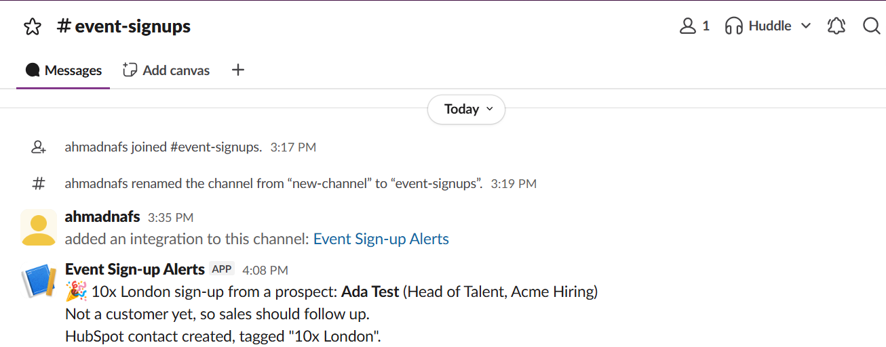
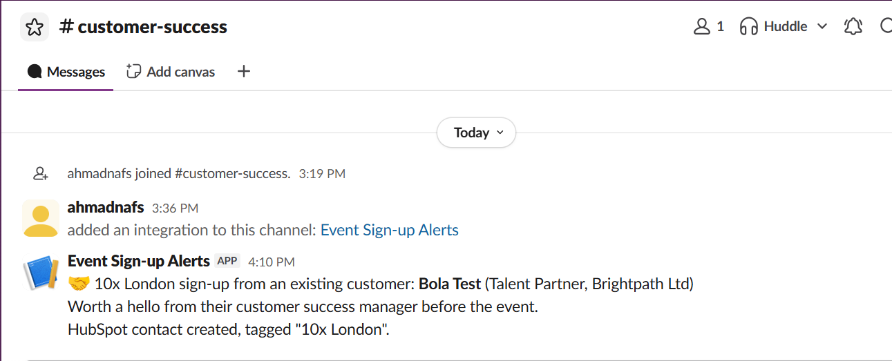

# Event sign-ups → HubSpot + Slack

A small integration that takes every event sign-up from a Tally form, saves the person in HubSpot tagged with the event, and alerts the right team in Slack.

- **New prospects** are created in HubSpot at lifecycle stage Lead and posted to **#event-signups** so sales can follow up.
- **Existing customers** are posted to **#customer-success** so their success manager can say hello before the event.
- **Repeat sign-ups** update the existing contact instead of creating a duplicate, and never move a contact back to an earlier lifecycle stage.




## How it works

```
Tally form ──webhook──▶ AWS Lambda (Python) ──▶ HubSpot contact
                               │
                               └──────────────▶ Slack: #event-signups or #customer-success
```

1. Tally sends each form submission to a Lambda Function URL.
2. The function checks the `Tally-Signature` header, so only real submissions get through.
3. It maps the form answers to HubSpot properties and creates or updates the contact by email.
4. It posts to the sales or customer success channel, depending on the "Are you already a customer?" answer.
5. If HubSpot fails, the function returns an error and Tally retries the delivery later, so no sign-up is lost.

## Built with

- Python 3.12 on AWS Lambda (standard library only, nothing to install)
- HubSpot CRM API v3 (private app token, contacts read and write scopes)
- Slack incoming webhooks
- Tally webhooks with signature verification

## Setup

1. In HubSpot, create two single-line text contact properties: `event_source` and `existing_customer`.
2. Create a HubSpot private app with the `crm.objects.contacts.read` and `crm.objects.contacts.write` scopes.
3. Create a Slack app with two incoming webhooks, one for each channel.
4. Create a Lambda function (Python 3.13, 10-second timeout) with `lambda_function.py`, and add a Function URL.
5. Add these environment variables in Lambda:

| Variable | What it is |
| --- | --- |
| `HUBSPOT_TOKEN` | HubSpot private app access token |
| `SLACK_WEBHOOK_URL` | Webhook for #event-signups |
| `SLACK_CS_WEBHOOK_URL` | Webhook for #customer-success |
| `TALLY_SIGNING_SECRET` | Signing secret set on the Tally webhook |
| `EVENT_NAME` | The tag stamped on each contact, e.g. `London meetup` |

6. In Tally, add the Function URL as a webhook with the same signing secret.

No tokens or webhook URLs live in this repo. They are all read from environment variables.

## Testing

`send_test_signup.py` sends sample sign-ups to the Function URL, signed the same way Tally signs them, so the whole flow can be tested without filling in the form each time.

1. Copy `.env.example` to `.env` and add your Function URL (and signing secret, once set). `.env` is git-ignored.
2. From this folder, run one test at a time:

```
python send_test_signup.py prospect   # new prospect: #event-signups, lifecycle stage Lead
python send_test_signup.py customer   # existing customer: #customer-success
python send_test_signup.py repeat     # same email, new job title: contact updated, no duplicate
python send_test_signup.py badsig     # wrong signature: rejected with 401
```

## Files

| File | What it is |
| --- | --- |
| `lambda_function.py` | The Lambda function |
| `send_test_signup.py` | Sends signed sample sign-ups for testing |
| `.env.example` | Template for local test settings |
| `slack-alerts.png` | Screenshot of the Slack alerts |

## What I'd add next

- Associate sign-ups with open deals, so the team can see which events influence pipeline.
- Skip duplicate Slack alerts when Tally retries a delivery.
- Add a weekly summary of sign-ups per event.
